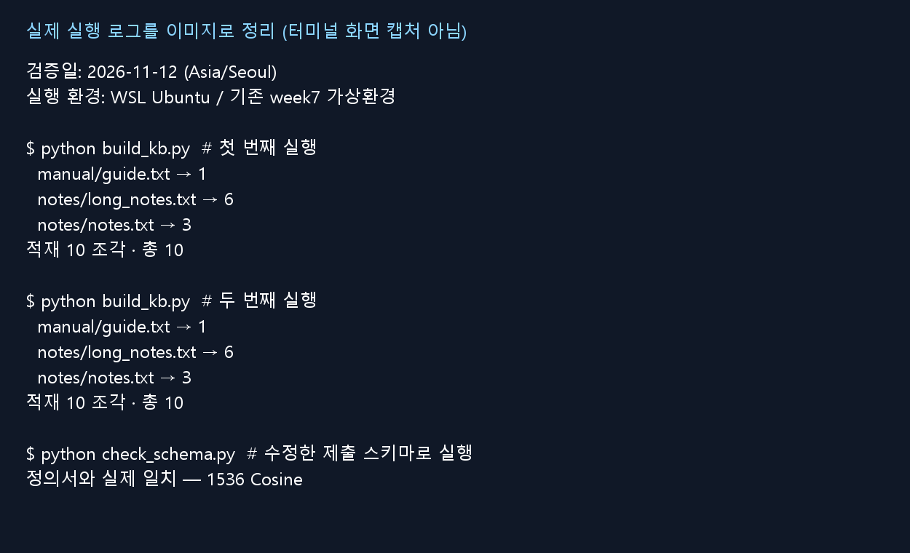

# 7주차 산출물 — 벡터 스키마와 지식베이스 구축

MinIO의 텍스트 문서를 분할하고 OpenAI 임베딩으로 변환하여 Qdrant에 저장하는 실습입니다.

## 제출 파일

- `vector-schema.yaml`: 실제 사용한 text-embedding-3-small, 1536차원, Cosine, chunk 300/overlap 30
- `build_kb.py`: MinIO → 분할 → 임베딩 → Qdrant 적재
- `rag_env.py`, `minio_env.py`: 기존 실습 연결 모듈
- `check_schema.py`: 모델 차원과 컬렉션 크기 대조
- `evidence/validation.txt`, `evidence/validation.png`: 실제 검증 결과. PNG는 실행 로그를 렌더링한 이미지이며 원본 터미널 스크린샷은 아닙니다.

## 실행

Python 3.12와 MinIO(localhost:9000), Qdrant(localhost:6333)가 필요합니다.
MinIO의 `raw-docs` 버킷에 UTF-8 .txt 문서를 먼저 준비하세요.
MinIO 연결 모듈은 강의 로컬 실습 계정 minioadmin/minioadmin을 사용합니다.

```bash
python3 -m venv .venv
source .venv/bin/activate
pip install -r requirements.txt
cp .env.example .env
# .env에 개인 OpenAI 키 입력 (Git에 올리지 않음)
python build_kb.py
python build_kb.py
python check_schema.py
```

## 실제 검증 — 2026-11-12

```text
첫 번째: 적재 10 조각 · 총 10
두 번째: 적재 10 조각 · 총 10
정의서와 실제 일치 — 1536 Cosine
```

원본 문서 3개(manual/guide.txt, notes/long_notes.txt, notes/notes.txt)를 사용했습니다.
문서 원문과 .env는 제출 저장소에 포함하지 않았으며 다른 문서를 넣으면 조각 수가 달라집니다.

같은 source의 기존 조각을 지우고 UUID5(source + "#" + chunk_index) ID로 다시 적재합니다.
이번 검증은 동일 입력의 반복 실행 결과를 확인한 것이며, 실패 중 원자적 복구나 원천에서 삭제된 문서의 동기화까지 보장하지 않습니다.

첨부 PDF는 예전 기본값(500/50)을 제시하지만, 함께 제공된 최신 수업 본문과 실제 실습 파일의 300/30을 적용했습니다.
기존 스키마의 Ollama 768차원 표기를 실제 OpenAI 경로의 1536차원으로 수정했습니다.


